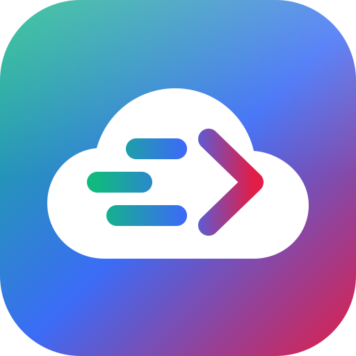

<p align="center"></p>

<h1 align="center">Drive to MEGA</h1>

<p align="center">Copy files and folders from <b>Google Drive</b> to <b>MEGA</b>, straight from your browser.<br>
No server, no sign-up, no install. Installable as an app on desktop and mobile.</p>

<p align="center"><a href="https://drivetomega.github.io/"><b>drivetomega.github.io</b></a></p>

---

## Features

- **Whole folders.** Recursive copy that recreates the folder structure. Existing MEGA folders are reused, shortcuts are followed, and shortcut loops are detected.
- **Every Drive view.** My Drive, Shared with me, Starred, Recent and Shared drives, plus Drive-wide search, an instant filter, sorting and shift-click range selection.
- **Google Docs export.** Docs, Sheets, Slides and Drawings are exported to Office formats or PDF, or skipped.
- **Duplicate handling.** Skip files that already exist (same name and size), keep both with automatic `name (1).ext` renaming, or upload anyway.
- **Resilient queue.** Automatic retries with back-off for rate limits, 5xx errors and network drops. A stall watchdog, pause/resume, per-file retry, cancel and remove. The queue auto-pauses when you go offline and pauses until you renew an expired Google session.
- **Live progress.** Overall progress, speed, ETA, progress in the tab title, status filters, and a CSV log export.
- **Streaming.** Large files are piped from Drive into MEGA's client-side encryption chunk by chunk and never sit fully in memory.
- **PWA.** Installable, works offline (shell), keeps the screen awake during transfers, sends a system notification when done, offers app shortcuts, and has a mobile tab bar layout.
- **Accessible.** Keyboard shortcuts (press `?`), screen-reader labels and live regions, reduced-motion support, light and dark themes.

## How it works

```
Google Drive API ──(read-only token)──▶ your browser ──(megajs, encrypted)──▶ MEGA
```

- **Google Drive** uses Google Identity Services with the `drive.readonly` scope. The token lives in memory only.
- **MEGA** uses [megajs](https://github.com/qgustavor/mega), vendored and SRI-pinned, with 2FA support. Your password is used locally and never stored.
- **There is no backend.** Your own connection carries both the download and the upload, so keep the tab or app open until the queue finishes.

## Setup

👉 **[docs/GOOGLE_OAUTH_SETUP.md](docs/GOOGLE_OAUTH_SETUP.md)** is the step-by-step guide to creating the Google OAuth Client ID, saving it as the `GOOGLE_CLIENT_ID` GitHub secret, and deploying.

In short:

1. Create a **Web application** OAuth client in Google Cloud with the origin `https://drivetomega.github.io`. Use the **Client ID** only and never the client secret.
2. Add it under **Settings → Secrets and variables → Actions** as `GOOGLE_CLIENT_ID`.
3. Set **Settings → Pages → Source** to **GitHub Actions**, then push to `main`.

Without step 2, the app still works. Each user pastes a Client ID in **⚙ Settings**.

## Local development

```bash
node scripts/build.mjs                                 # builds ./_site and runs the security checks
npx serve -l 8080 _site                                # open http://localhost:8080
GOOGLE_CLIENT_ID=…apps.googleusercontent.com node scripts/build.mjs   # bake a Client ID in locally
```

Google sign-in needs `http://localhost:8080` in the client's authorized origins. Opening the HTML with `file://` won't work. The site uses root-relative paths, so serve it from the root of an origin (a user or organisation Pages site, or a custom domain).

## Project layout

```
index.html               App + landing page (SEO, JSON-LD, CSP)
assets/js/app.js         Application logic
assets/js/theme-init.js  Pre-paint theme and anti-framing guard
assets/js/config.js      Site config (Client ID injected at deploy)
assets/css/app.css       Styles, preloader and responsive/mobile shell
assets/vendor/           megajs 1.3.10 (MIT) + licence
assets/icons/            Logo, favicons, PWA and maskable icons, notification badge
sw.js                    Service worker (same-origin static cache only)
manifest.webmanifest     PWA manifest (icons, screenshots, shortcuts)
privacy.html, terms.html Policies required by the Google OAuth consent screen
scripts/build.mjs        Build: copy public files, inject Client ID, SW version, SRI and CSP checks
.github/workflows/       Build on PRs, deploy to Pages from main
```

## Limits worth knowing

- **Google sessions last about an hour.** New transfers pause and a **Renew** button appears. One click resumes the queue.
- **Google export cap.** Docs, Sheets and Slides exports are limited to about 10 MB each.
- **Restricted scope.** In *Testing* mode, only up to 100 listed test users can sign in. Public use requires Google verification and a security assessment (see the setup guide).
- **Very large libraries.** For multi-terabyte unattended copies, run `rclone copy gdrive: mega:` on a server.

## Security & privacy

See [SECURITY.md](SECURITY.md) for the threat model and controls, and [privacy.html](https://drivetomega.github.io/privacy.html) for the privacy policy.

*Not affiliated with Google LLC or MEGA Limited. Google Drive and MEGA are trademarks of their respective owners.*
